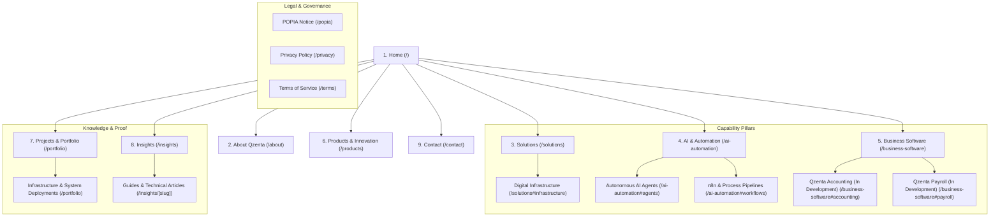

# Qzenta Website Architecture Specification
**Branch:** `website/2026-10-transformation`  
**Status:** Planning & Architecture (Batch 2)  
**Entity:** Qzenta (Pty) Ltd (CIPC Registered 22 May 2026)  
**Positioning:** AI-native business technology, software and automation  
**Tagline:** Quietly Excellent  

---

## 1. Executive Summary & Architectural Goals

This document establishes the structural information architecture for the transformed Qzenta web platform (`www.qzenta.com`). The architecture transitions Qzenta from a legacy web agency/hosting brochure site into an authoritative, enterprise-grade AI-native technology entity delivering:
1. **Digital Infrastructure** (operational infrastructure, managed hosting, domains, cloud integrations);
2. **Intelligent Automation** (AI agents, business process automation, n8n workflows, system integrations);
3. **Business Software** (proprietary business applications, integrated SME platforms, with Qzenta Accounting and Qzenta Payroll transparently presented as products in active development).

### Key Architectural Objectives
- **Pillar-Driven Organization:** Elevate the three core capabilities into primary first-class sections.
- **Route Consolidation:** Eliminate route fragmentation and duplication (specifically merging `/resources` and `/insights`, and folding `/services` into `/solutions`).
- **Development Status Transparency:** Create dedicated product surfaces that clearly distinguish production-ready operational services from software platforms in active development.
- **SEO & Link Equity Preservation:** Implement strict HTTP 301 permanent redirect mappings for all legacy routes to avoid broken links and consolidate domain authority.
- **Scalable Content Infrastructure:** Provide a single canonical content pipeline for technical whitepapers, architectural guides, and sector roadmaps.

---

## 2. Proposed Page Map

The platform is structured across nine primary public sections, complemented by compliance and metadata endpoints:



### Detailed Section Definitions

| Section | Route | Page Title | Primary Purpose | Key Content Blocks |
|---|---|---|---|---|
| **1. Home** | `/` | Qzenta — AI-Native Business Technology, Software & Automation | High-impact overview of Qzenta's positioning, three core capabilities, proven stack, products in development, and direct engagement paths. | Hero with value proposition, 3-pillar capability matrix, operational vs development distinction, technical foundations, featured insights, direct engagement CTA. |
| **2. About Qzenta** | `/about` | About Qzenta — Quietly Excellent Business Technology | Entity identity, CIPC registration, operating philosophy, boutique focus, and technical leadership. | Founding story (May 2026), core values (Ownership, Simplicity, Transparency, Longevity), standard stack, entity governance, Johannesburg headquarters. |
| **3. Solutions** | `/solutions` | Solutions — Digital Infrastructure & Managed Tech Services | Detailed catalog of operational digital infrastructure services. | High-performance websites (Next.js), enterprise DNS/CDN (Cloudflare), managed hosting (Vercel), domain lifecycle management, cloud integrations, sector frameworks. |
| **4. AI and Automation** | `/ai-automation` | AI & Automation — Intelligent Agents & Business Workflows | Technical overview of agentic AI systems, workflow orchestration, and automated pipelines. | Specialized AI agents (reception, lead triage, proposal generation, compliance monitoring), n8n workflow pipelines, API bridges, security & human-in-the-loop controls. |
| **5. Business Software** | `/business-software` | Business Software — Integrated SME Applications | Hub for Qzenta's proprietary application suite, clearly stating development status. | Architecture of modern business software, Qzenta Accounting (In Development), Qzenta Payroll & HR (In Development), integrated ERP/SME roadmap, early-access waitlist. |
| **6. Products and Innovation** | `/products` | Products & Innovation — R&D, Roadmaps & Technology Lab | Transparency portal showcasing Qzenta's software development lifecycle, engineering milestones, and upcoming releases. | Product vision, release roadmap, engineering principles, R&D experiments, design partner program. |
| **7. Projects and Portfolio** | `/portfolio` | Projects & Portfolio — Technical Implementations & Architecture | Anonymized case studies and architectural reviews of production systems deployed across client organizations. | Multi-sector deployments (professional services, property, SaaS, NGO, legal), architecture diagrams, stack breakdowns, operational outcomes. |
| **8. Insights** | `/insights` | Insights — Technical Guides, Architecture & Business Automation | Single canonical publication hub for long-form guides, operational blueprints, and technology perspectives. | Searchable/filterable article index, reading times, publication dates, author metadata, cross-links to capabilities. |
| **8.1 Dynamic Insight** | `/insights/[slug]` | `[Article Title]` — Qzenta Insights | Static site-generated deep-dive technical articles. | Full article body, structured table of contents, code blocks, technical takeaways, context CTA. |
| **9. Contact** | `/contact` | Contact Qzenta — Technical Consultations & Inquiries | Direct communications portal connecting business leaders directly to technical builders. | Direct communication channels (email `info@qzenta.com`, optional WhatsApp), encrypted Brevo-powered inquiry form, SLA expectations, office location. |
| **Legal: POPIA** | `/popia` | POPIA Compliance Notice — Qzenta (Pty) Ltd | Statutory personal information processing notice under Act 4 of 2013. | Information Officer designation, data collection scope, processing purposes, data retention, subject access rights, Information Regulator contacts. |
| **Legal: Privacy** | `/privacy` | Privacy Policy — Qzenta (Pty) Ltd | Transparent privacy statement covering site visitors and prospective clients. | Data handling policies, third-party processors (Brevo, Vercel, Cloudflare), cookie-less telemetry, rights exercise. |
| **Legal: Terms** | `/terms` | Terms of Service — Qzenta (Pty) Ltd | Standard terms governing site access and preliminary commercial engagement. | Intellectual property, limitations of liability, governing law (Republic of South Africa), jurisdiction. |

---

## 3. Comprehensive Route Migration & Redirect Map

Every route currently present in the codebase has been audited and mapped. No dead routes, orphaned pages, or duplicate indexing will be permitted.

| Existing Route | Status in Current Code | Proposed Target Route | HTTP Response / Status | Content Action & Rationalization |
|---|---|---|---|---|
| `/` | Live static page | `/` | `200 OK` (Kept) | Redesign around AI-native positioning, three capabilities, and clear development statuses. |
| `/about` | Live static page | `/about` | `200 OK` (Kept) | Retained and refreshed to reflect AI-native business technology entity, CIPC governance, and dark navy brand system. |
| `/contact` | Live static page with form | `/contact` | `200 OK` (Kept) | Retained. Integrates direct builder inquiry workflow and Brevo API handler. |
| `/services` | Live static page | `/solutions` | `301 Permanent Redirect` (Merged) | Merged into `/solutions`. Having both `/services` and `/solutions` caused semantic ambiguity and duplicate keyword cannibalization. |
| `/solutions` | Live static page | `/solutions` | `200 OK` (Kept) | Refocused exclusively on Digital Infrastructure and Managed Services, cross-linking to `/ai-automation`. |
| `/industries` | Live static page | `/solutions#industries` | `301 Permanent Redirect` (Merged) | Merged into `/solutions` as a dedicated sector application matrix rather than maintaining an isolated thin subpage. |
| `/portfolio` | Live static page | `/portfolio` | `200 OK` (Kept) | Retained. Positioned as "Projects and Portfolio" emphasizing technical systems, architectures, and client outcomes. |
| `/insights` | Live static page | `/insights` | `200 OK` (Kept & Unified) | Designated as the single, canonical knowledge hub. |
| `/insights/[slug]` | Live SSG dynamic route | `/insights/[slug]` | `200 OK` (Kept & Unified) | Retained as the dynamic publication route. Static generation powered by `lib/posts.ts`. |
| `/resources` | Live duplicate of `/insights` | `/insights` | `301 Permanent Redirect` (Merged) | Redundant legacy duplicate. Permanently redirected to `/insights`. |
| `/resources/[slug]` | Live duplicate of `/insights/[slug]` | `/insights/:slug` | `301 Permanent Redirect` (Merged) | Redundant legacy dynamic route. Permanently redirected to `/insights/:slug`. |
| `/popia` | Live static page | `/popia` | `200 OK` (Kept) | Retained and harmonized with verified CIPC director and Information Officer records. |
| `/privacy` | Live static page | `/privacy` | `200 OK` (Kept) | Retained. Updated to reflect unified site privacy architecture. |
| `/terms` | Live static page | `/terms` | `200 OK` (Kept) | Retained. Governed by South African law. |
| `/api/contact` | Dynamic API route handler | `/api/contact` | `200 OK` (Kept) | Maintained for form submissions, Brevo SMTP integration, and server-side validation. |
| `/sitemap.xml` | Metadata route (`app/sitemap.ts`) | `/sitemap.xml` | `200 OK` (Updated) | Updated to index only canonical URLs (`/insights`), purging `/resources` and `/services`. |
| `/robots.txt` | Metadata route (`app/robots.ts`) | `/robots.txt` | `200 OK` (Kept) | Maintained to guide crawlers to `https://www.qzenta.com/sitemap.xml`. |
| `/opengraph-image` | Dynamic OG image generator | `/opengraph-image` | `200 OK` (Kept) | Maintained with updated brand messaging ("AI-Native Business Technology"). |

---

## 4. Consolidation Strategy: Merging `/insights` and `/resources`

### 4.1 Diagnosis of Current Duplication
In the current repository:
- `app/insights/page.tsx` and `app/resources/page.tsx` render identical content from `lib/posts.ts` with minor CSS differences.
- `app/insights/[slug]/page.tsx` and `app/resources/[slug]/page.tsx` render identical individual blog posts.
- The global navigation (`components/Nav.tsx`) links visitors to `/insights`.
- The XML sitemap generator (`app/sitemap.ts`) indexes `/resources` and `/resources/[slug]`.
- This creates internal link competition, duplicate content penalties in search engine indexes, and inconsistent analytics tracking.

### 4.2 Migration Execution Blueprint
1. **Canonical Selection:** `/insights` is selected as the permanent, authoritative route name. "Insights" conveys senior technical and strategic authority, aligning with enterprise technology positioning.
2. **Next.js Route Configuration:** Configure permanent redirects in `next.config.ts`:
   ```typescript
   async redirects() {
     return [
       {
         source: '/resources',
         destination: '/insights',
         permanent: true,
       },
       {
         source: '/resources/:slug',
         destination: '/insights/:slug',
         permanent: true,
       },
       {
         source: '/services',
         destination: '/solutions',
         permanent: true,
       },
       {
         source: '/industries',
         destination: '/solutions#industries',
         permanent: true,
       },
     ];
   }
   ```
3. **Sitemap Alignment:** Update `app/sitemap.ts` to output canonical URLs under `/insights/` and eliminate `/resources/` entirely.
4. **File System Cleanup:** Once redirects are active, remove `app/resources/` directory and deprecate legacy paths.

---

## 5. Navigation Architecture & Hierarchy

### 5.1 Desktop Header Navigation (`components/Nav.tsx`)

The navigation header employs a clean, high-contrast, two-tier layout built for rapid orientation:

```
+--------------------------------------------------------------------------------------------------------------------+
| TOP UTILITY BAR (bg-slate-900 / text-slate-400):                                                                    |
| CIPC Registered (22 May 2026) | Johannesburg, South Africa                     info@qzenta.com | GitHub: @qzenta   |
+--------------------------------------------------------------------------------------------------------------------+
| MAIN BRAND BAR (bg-navy / sticky):                                                                                 |
| [Q] QZENTA  "Quietly Excellent"      Solutions [v]    AI & Automation    Business Software [v]    Portfolio   Insights |
|                                                                                      [ Initiate Project / CTA ]    |
+--------------------------------------------------------------------------------------------------------------------+
```

#### Dropdown Flyout Structures

1. **Solutions Flyout (Digital Infrastructure):**
   - *Website Engineering:* High-performance Next.js production deployments.
   - *Managed Hosting & Vercel:* Serverless edge infrastructure, global caching, automated rollbacks.
   - *Cloudflare DNS & Security:* Enterprise DDoS mitigation, SSL management, zero-downtime cutovers.
   - *Domain Lifecycle Management:* End-to-end .co.za and .com portfolio oversight.
   - *Sector Solutions:* Tailored infrastructure for professional services, property, legal, and NGO sectors.

2. **Business Software Flyout (Applications & Innovation):**
   - *Business Software Overview:* Integrated SME software architecture.
   - *Qzenta Accounting:* Modern cloud ledger and compliance software *(Status: In Active Development)*.
   - *Qzenta Payroll & HR:* Statutory payroll, PAYE and employee management *(Status: In Active Development)*.
   - *Products & Innovation Lab:* Architectural blueprints, R&D progress, and beta roadmaps.

3. **Direct Primary Links:**
   - *AI & Automation:* Dedicated portal to AI agent deployment and n8n workflow systems.
   - *Portfolio:* Architectural reviews and delivered project case studies.
   - *Insights:* Technical guides, articles, and whitepapers.
   - *About:* Entity background, governance, stack, and philosophy.
   - *Header CTA Button:* Emerald button leading to `/contact` ("Get in Touch").

### 5.2 Mobile Drawer Navigation

When viewed on viewport widths `< 1024px`, the navigation consolidates into an accessible full-height slide-over drawer:
- **Brand Header:** Geometric Q mark + wordmark + close trigger.
- **Section 1: Capabilities:**
  - Solutions (Digital Infrastructure)
  - AI & Automation (Agents & n8n Workflows)
  - Business Software (Accounting & Payroll — tagged *In Development*)
- **Section 2: Company & Proof:**
  - Projects & Portfolio
  - Technical Insights
  - About Qzenta
- **Section 3: Direct Actions:**
  - "Contact Technical Team" (Primary emerald button)
  - Direct WhatsApp link (conditional on `NEXT_PUBLIC_WHATSAPP_NUMBER`)
  - Direct email: `info@qzenta.com`
- **Drawer Footer:** CIPC registration notice and copyright.

### 5.3 Global Footer Navigation (`components/Footer.tsx`)

A structured 5-column architecture reinforcing technical authority, entity legitimacy, and comprehensive legal compliance:

```
+--------------------------------------------------------------------------------------------------------------------+
| QZENTA (PTY) LTD                                                                                                   |
| AI-native business technology, software and automation.                                                            |
| Quietly Excellent.                                                                                                 |
+----------------------+----------------------+----------------------+----------------------+------------------------+
| CAPABILITIES         | SOFTWARE IN DEV      | COMPANY & PROOF      | INSIGHTS & GUIDES    | LEGAL & GOVERNANCE     |
| - Digital Infra      | - Qzenta Accounting  | - About Qzenta       | - All Technical Guides| - POPIA Notice        |
| - AI Agents          |   (In Development)   | - Projects & Work    | - SME IT Playbook    | - Privacy Policy       |
| - n8n Workflows      | - Qzenta Payroll     | - Tech Stack Specs   | - Cloudflare Security| - Terms of Service     |
| - Managed Hosting    |   (In Development)   | - Direct Builder Model| - CIPC to Go-Live   | - Information Officer  |
| - Cloud Integrations | - Product Roadmap    | - Direct Contact     | - Automation Index   | - CIPC: 2026/XXXXXX/07 |
+----------------------+----------------------+----------------------+----------------------+------------------------+
| BOTTOM BAR:                                                                                                        |
| (c) 2026 Qzenta (Pty) Ltd. Registered in the Republic of South Africa. All rights reserved.                        |
+--------------------------------------------------------------------------------------------------------------------+
```

---

## 6. Inventory Rationalization: Kept, Merged, and Removed

To maintain maximum codebase efficiency and eliminate clutter, all project files and assets are classified into three strict categories:

### 6.1 What is Kept (Maintained & Enhanced)
- `app/page.tsx`: Transformed to reflect the 3 capabilities, positioning, and products in development.
- `app/about/page.tsx`: Enhanced to highlight holding entity governance, boutique direct access, and stack consistency.
- `app/contact/page.tsx`: Maintained with contact form and direct WhatsApp / email access.
- `app/portfolio/page.tsx`: Maintained and framed around systems architecture and operational project outcomes.
- `app/insights/page.tsx` & `app/insights/[slug]/page.tsx`: Kept as the sole canonical content hub.
- `app/popia/page.tsx`, `app/privacy/page.tsx`, `app/terms/page.tsx`: Retained and synchronized with corporate records.
- `app/api/contact/route.ts`: Retained as the production serverless contact handler (Brevo HTTP API).
- `app/layout.tsx`: Retained with Schema.org Organization structured data, Geist typography, and analytics loaders.
- `components/AssessmentForm.tsx`: Retained as the interactive assessment funnel dispatching to n8n webhook.
- `components/ContactForm.tsx`: Retained as the primary client inquiry component.
- `components/GoogleAnalytics.tsx`: Retained with dynamic domain routing (`.com` vs `.co.za`).
- `components/MicrosoftClarity.tsx`: Retained for UX session diagnostics.
- `lib/posts.ts`: Retained as the structured data store for insights and technical articles.
- `public/qzenta-icon.svg` & `public/logo.png`: Retained as official brand assets.

### 6.2 What is Merged (Consolidated & Redirected)
- `app/resources/page.tsx` -> **Merged into** `app/insights/page.tsx` (permanent 301 redirect).
- `app/resources/[slug]/page.tsx` -> **Merged into** `app/insights/[slug]/page.tsx` (permanent 301 redirect).
- `app/services/page.tsx` -> **Merged into** `app/solutions/page.tsx` (permanent 301 redirect).
- `app/industries/page.tsx` -> **Merged into** `app/solutions/page.tsx#industries` (permanent 301 redirect).

### 6.3 What is Removed / Deprecated
- `public/file.svg`: Unreferenced Next.js starter template SVG.
- `public/globe.svg`: Unreferenced Next.js starter template SVG.
- `public/next.svg`: Unreferenced Next.js starter template SVG.
- `public/vercel.svg`: Unreferenced Next.js starter template SVG.
- `public/window.svg`: Unreferenced Next.js starter template SVG.
- Conflicting pricing figures in legacy markup (specifically `R3,000 once-off / R200-R300 monthly` in legacy solutions versus `R8,500 / R750` in homepage packages) to be purged in favor of owner-confirmed engagement models.
